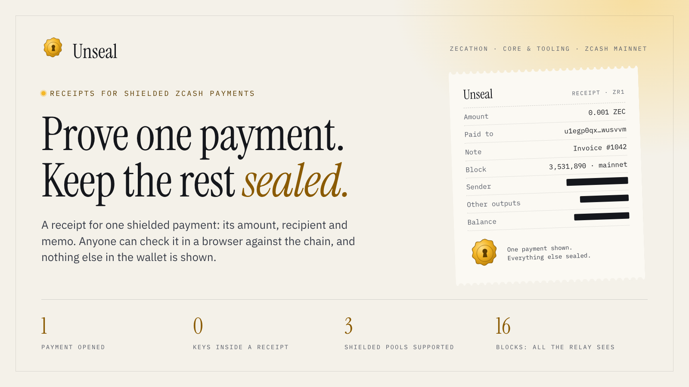
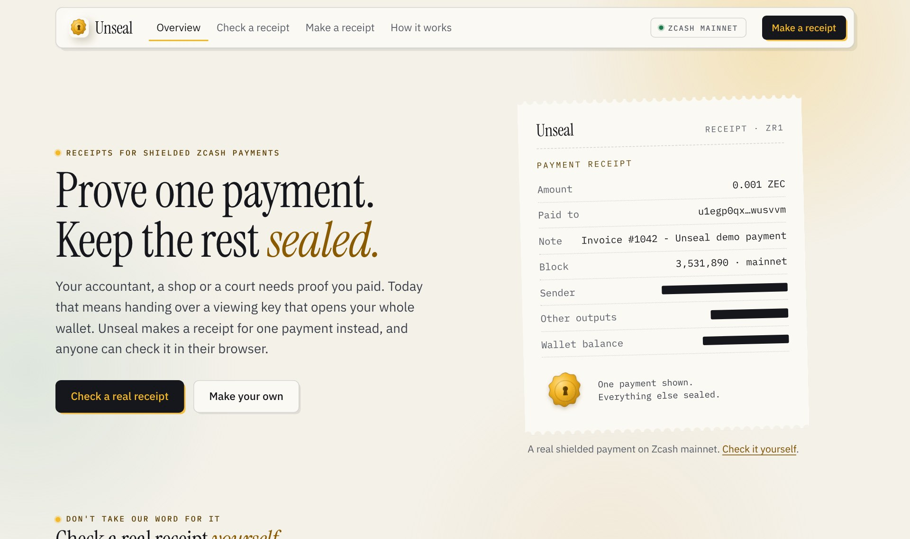
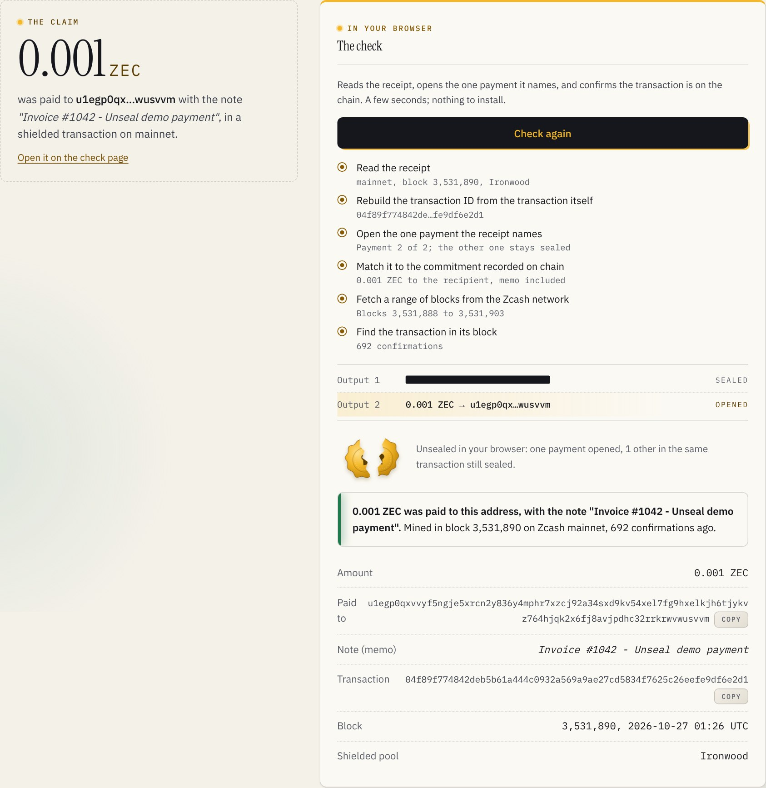
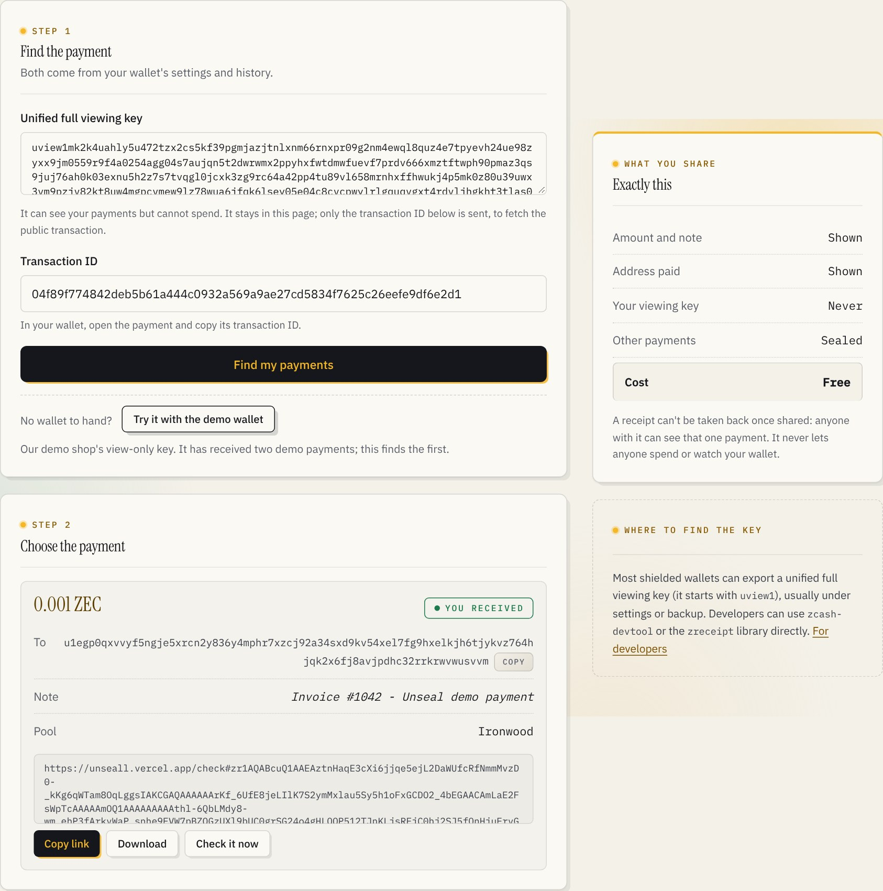
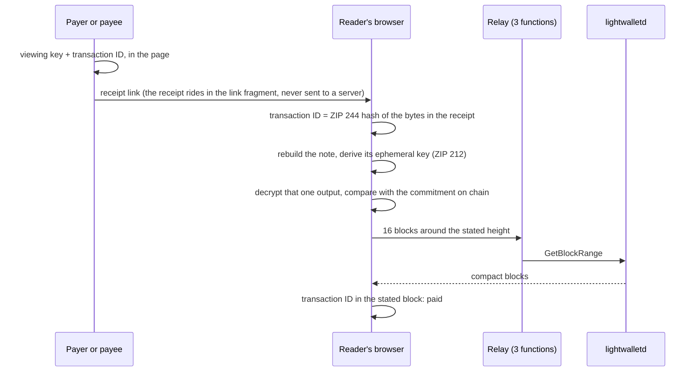

# Unseal



**Receipts for shielded Zcash payments. Prove one payment to anyone, and keep everything else private.**

Built for Zecathon, track 04: Core & Tooling. Live on Zcash mainnet:
**<https://unseall.vercel.app>** · two minute [demo video](docs/video/unseal-demo.mp4) · five minute walkthrough in
[docs/JUDGES.md](docs/JUDGES.md).

---

## The problem

Shielded Zcash payments are private by default, and that is the point. But people regularly need to show one payment to
someone: an accountant closing the books, an auditor, a client who says an invoice is unpaid, a support desk, a court.

Today the only way to do that is to hand over a viewing key. A viewing key opens the whole wallet: every payment, past and
future, and the balance. So people either reveal far more than they meant to, or they can't prove anything at all. For a
business that wants to take shielded payments, that is a real obstacle.

[ZIP 311](https://zips.z.cash/zip-0311) describes payment disclosures as the fix. It is still a draft, and we found no
wallet or tool that ships it.

## What Unseal is

1. **A receipt for one payment.** A short piece of text, `zr1…`, that carries the three private facts defining one shielded
   output (recipient, value and the note's random seed) next to the public transaction it sits in. It holds no key.
2. **A check anyone can run.** Open a receipt link and the reader's own browser recomputes the transaction ID, rebuilds the
   payment, decrypts exactly that one output and requires it to match the commitment on chain, then confirms the
   transaction is in its block. Change any detail and the check fails at the step that broke.
3. **A way to make receipts without giving up a key.** Paste a viewing key and a transaction ID; the page finds what that
   key sent or received and gives a link for each payment. The key never leaves the page.
4. **An engine for wallets and shops.** The same Rust library runs natively, in the browser as WebAssembly, and behind a
   command line tool with JSON output. It covers all three shielded pools: Orchard, Ironwood and Sapling.

What stays private: the sender, every other output in the transaction, the wallet's balance and history, and whether the
money was spent afterwards. Unseal implements the output side of ZIP 311.

## Product tour

Captured from the production build against Zcash mainnet.

**The home page.** The hero is a real receipt: a 0.001 ZEC payment mined in block 3,531,890.



**The check.** One click checks the receipt in the browser. Each step names what it proved; the opened payment sits
beside the output that stays sealed, and the wax seal cracks open.



**Making a receipt.** The demo shop's view only key finds the payment it received and turns it into a link, a file and a
check button, without the key leaving the page.



## Trying it

[**docs/JUDGES.md**](docs/JUDGES.md) is the five minute walkthrough: the three one click demos, a real Sapling receipt,
the command line tool, and how to check each claim against the chain or the test suite. No wallet, no account and no
setup.

## How a check works



| Claim | Why it holds |
|---|---|
| The amount, recipient and memo are what was paid | The note is rebuilt from the receipt and must equal the one committed on chain (`cmx` for Orchard and Ironwood, `cmu` for Sapling). The memo only decrypts with the key derived from that exact note. A higher amount, another address or another output fails. |
| The transaction is the one on chain | Its ID is recomputed from the receipt's own bytes (ZIP 244). Editing any payment data changes the ID, which is then not in the block. |
| It was mined | The ID appears in the block at the stated height, read from a public lightwalletd server. |
| Nothing else is revealed | The receipt holds no key. Its seed opens one note and does not reveal the note's nullifier, so it can't show when or whether the money moved on. |
| The relay can't tell what was checked | A check asks for an aligned range of 16 blocks, never a transaction. |

The full trust model, including what a receipt does not prove, is in [docs/SECURITY.md](docs/SECURITY.md).

## Documentation

| | |
|---|---|
| [`docs/JUDGES.md`](docs/JUDGES.md) | Five minute walkthrough for judges |
| [`docs/SECURITY.md`](docs/SECURITY.md) | What a receipt proves, what it doesn't, and what the checker trusts |
| [`docs/QUALITY.md`](docs/QUALITY.md) | Every test and audit, how to rerun it, and the result |
| [`docs/DEPLOY.md`](docs/DEPLOY.md) | Hosting the site, running your own relay, rebuilding the engine |
| [`docs/video/unseal-demo.mp4`](docs/video/unseal-demo.mp4) | The two minute demo video |
| [`docs/VIDEO.md`](docs/VIDEO.md) | How the video was made, and its script |
| [`docs/brand/`](docs/brand) | Logo, cover, mark and the script that renders them |

## Repository layout

```
core/              zreceipt: the receipt engine (Rust) and its WebAssembly bindings
  tests/data/      Real mainnet receipts (Ironwood and Sapling), a forged copy, a testnet transaction
cli/               unseal: the command line tool
web/               The site (Vite, React, TypeScript), pre-rendered
  api/             The relay: three stateless functions over lightwalletd
  src/zreceipt/    The engine compiled to WebAssembly (generated, committed)
api/               Entry points so the relay also deploys from the repository root
tools/
  e2e/             Browser checks of every flow against the live chain
  audit/           Accessibility, keyboard, 16 screen sizes, outages, Lighthouse
  brand/           The mark, and the scripts that render the brand images and screenshots
  video/           Records, voices and cuts the demo video from the live site
scripts/           Rebuilds the WebAssembly engine
docs/              Judge walkthrough, security model, quality record, deploy, video script
  brand/           Logo, cover and mark
  screens/         Product screenshots
  video/           The demo video
  hackathon/       Submission form text
```

## Status

| Component | State |
|---|---|
| `zreceipt`: make and check receipts for Orchard, Ironwood and Sapling | Built, 14 tests passing, including two real mainnet receipts and a forged copy |
| `unseal`: check, create and inspect from a terminal, with JSON output | Built |
| WebAssembly engine, used by every check on the site | Built |
| Relay: three functions over lightwalletd, mainnet and testnet | Live |
| Site: home, check, make, how it works | Live at <https://unseall.vercel.app> |
| Browser checks of every flow against mainnet (`tools/e2e`) | 51 passing |
| Interface audit (`tools/audit`) | 0 accessibility violations; 80 of 80 page and screen size combinations clean; Lighthouse 100 for accessibility, best practices and SEO |
| Real payments on mainnet | Ironwood: 0.001 ZEC, block 3,531,890. Sapling: 0.0005 ZEC, block 3,532,565 |

Nothing on the site is simulated. Every check, with its result, is in [docs/QUALITY.md](docs/QUALITY.md).

## Running it

```bash
# Engine and command line tool
cargo test --workspace
cargo run --release -p unseal-cli -- check core/tests/data/mainnet-demo.zr

# Site, with the relay inside the dev server
cd web && npm ci && npm run dev        # http://localhost:5173
```

The command line tool:

```bash
unseal check receipt.txt --address u1…        # verify, and confirm it paid your address
unseal create --key uview1… --txid 04f8…      # receipts for what a viewing key sent or received
unseal inspect zr1…                           # read a receipt without checking it
```

Every command takes `--json`. Deploying the site and rebuilding the engine are in [docs/DEPLOY.md](docs/DEPLOY.md).

## Limits

- **Chain inclusion trusts the lightwalletd server**, as a light wallet does. Anyone can run their own relay to take this
  site out of the path.
- **Receipts are 12 to 20 KB**, because they carry the transaction. They travel as links and files, not QR codes.
- **The sender is not identified.** A receipt is like a paper receipt: whoever holds it can show it. Signing receipts with
  the spend authorization key, the input side of ZIP 311, would add that.
- **Sapling receipts cover notes made since 2020** (ZIP 212). Older Sapling notes use a random ephemeral key that the
  receipt can't reproduce.

## Roadmap

1. **Sender signatures:** the input side of ZIP 311, so a receipt can also prove who paid.
2. **Receipts in wallets:** a "Share receipt" button beside each sent payment, built on `zreceipt` or its WebAssembly build.
3. **QR sized receipts:** leave the transaction out and fetch it by ID at check time.
4. **Header checks:** verify proof of work and chain position, so inclusion doesn't rest on one server.

## License

MIT or Apache 2.0, at your option.
